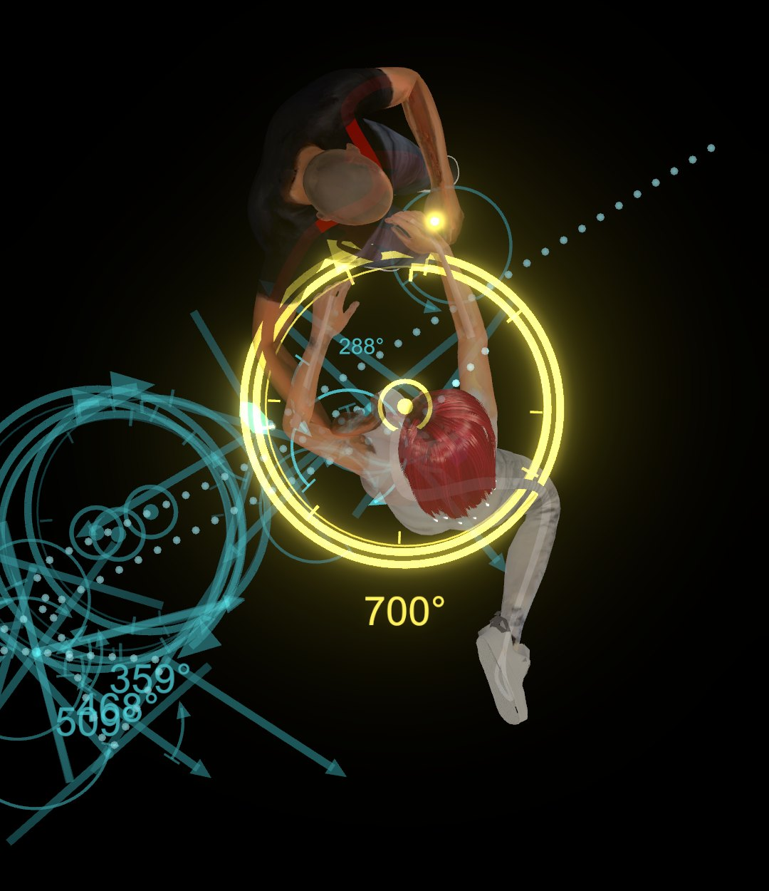
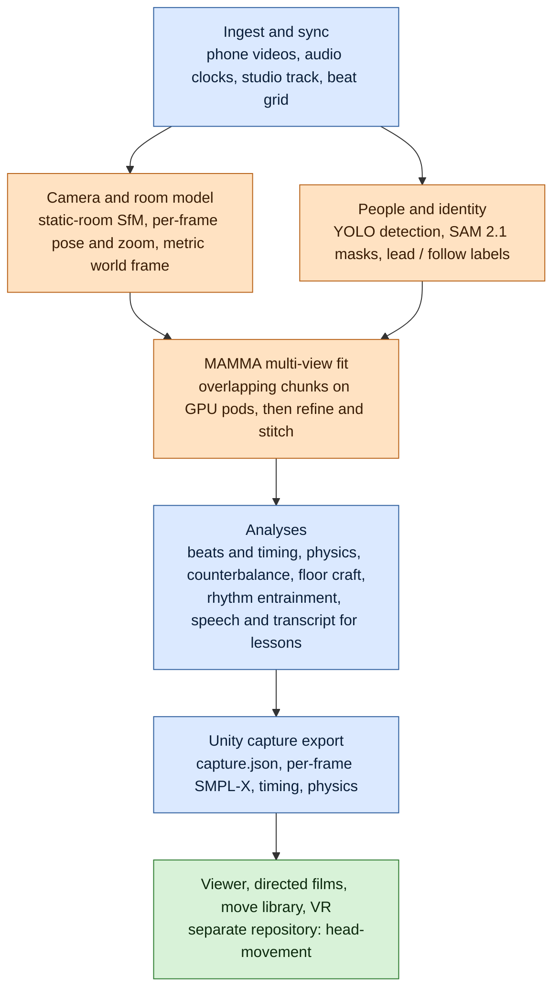
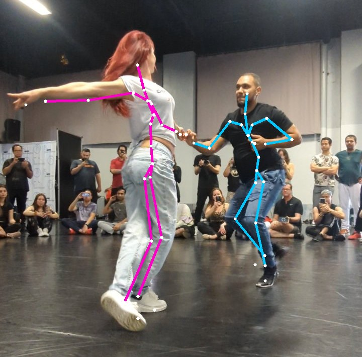
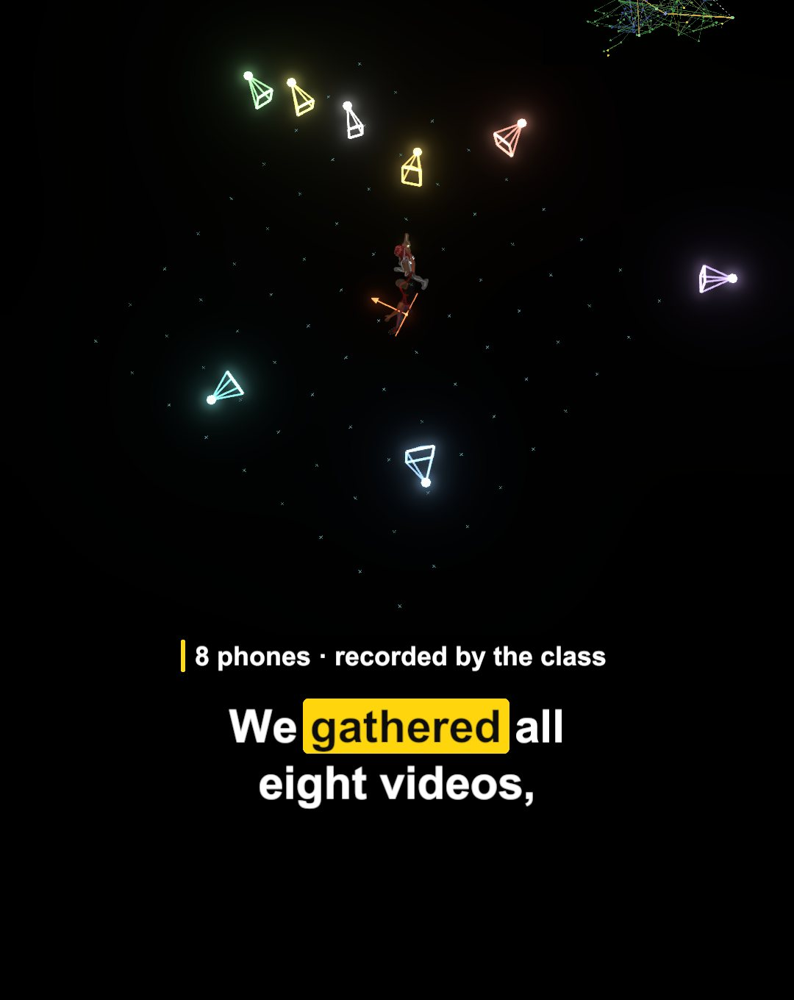
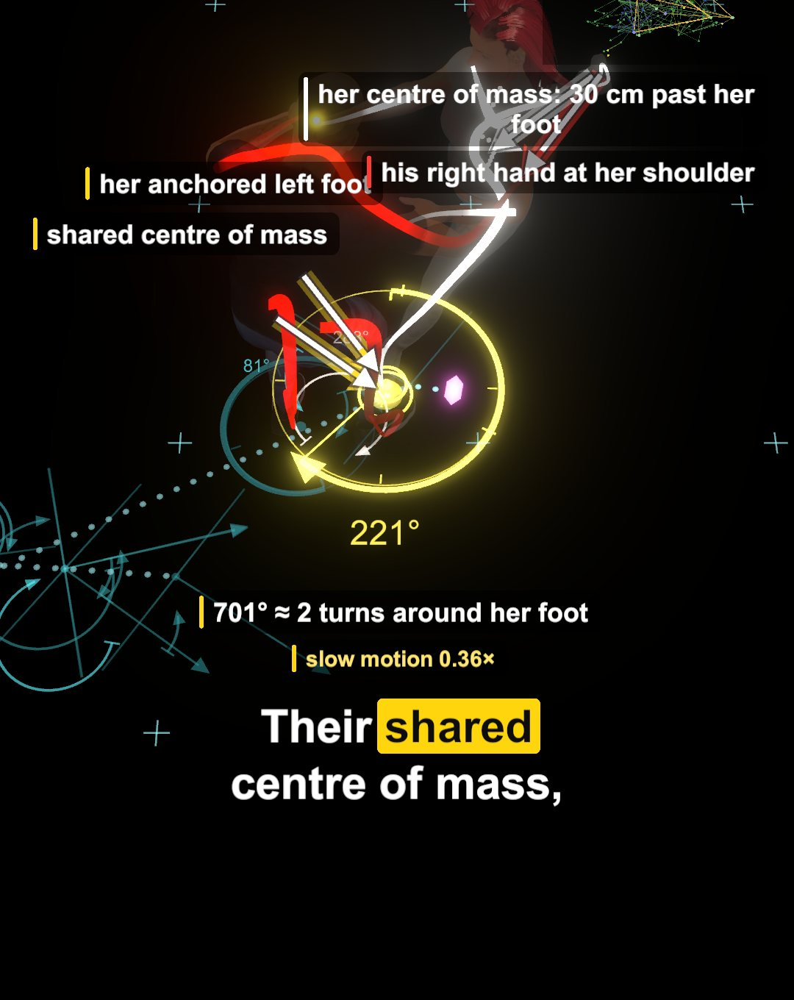
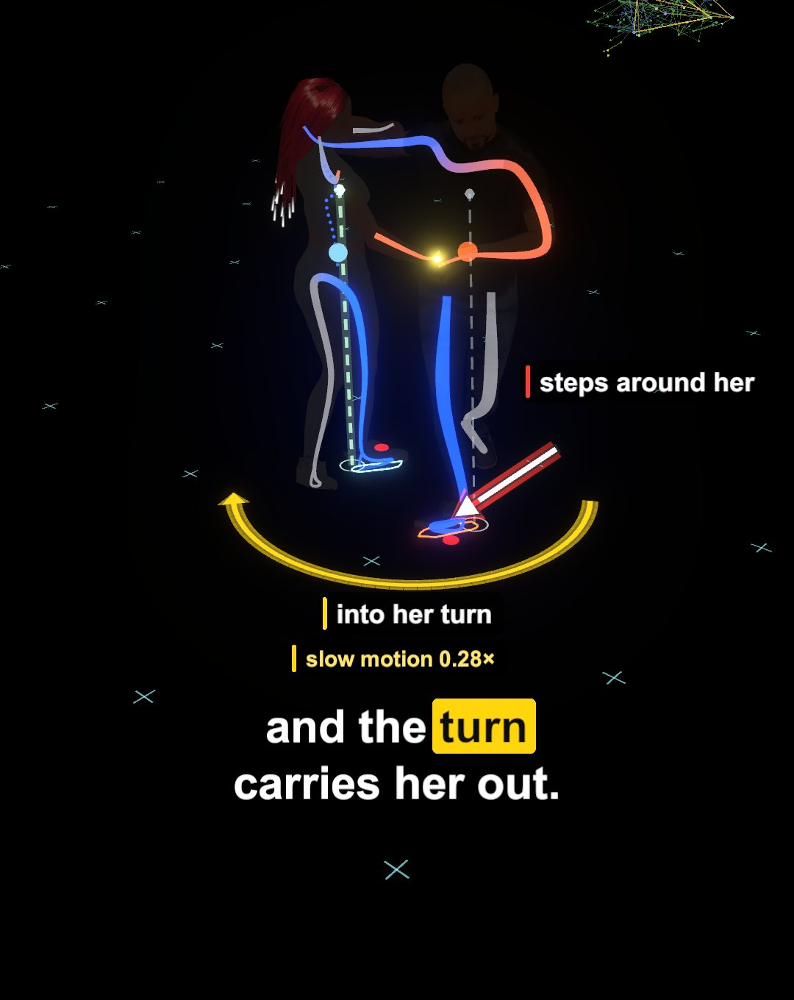
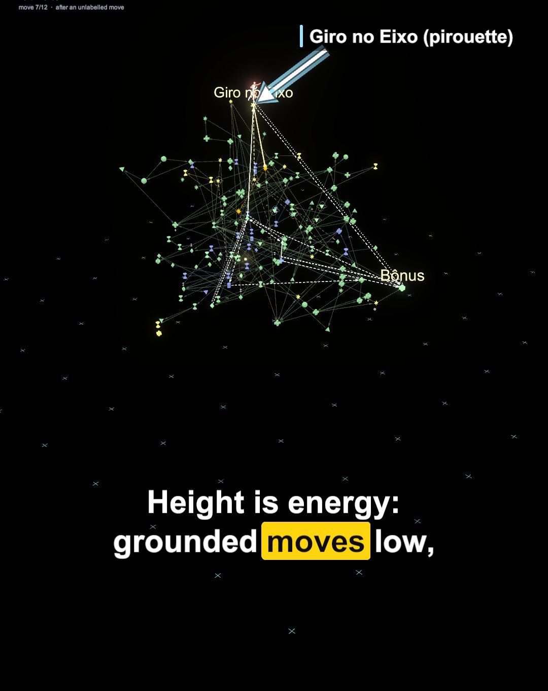
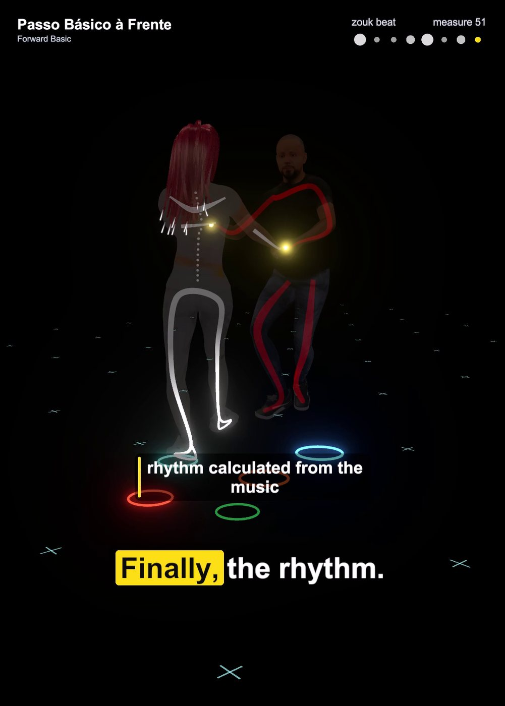
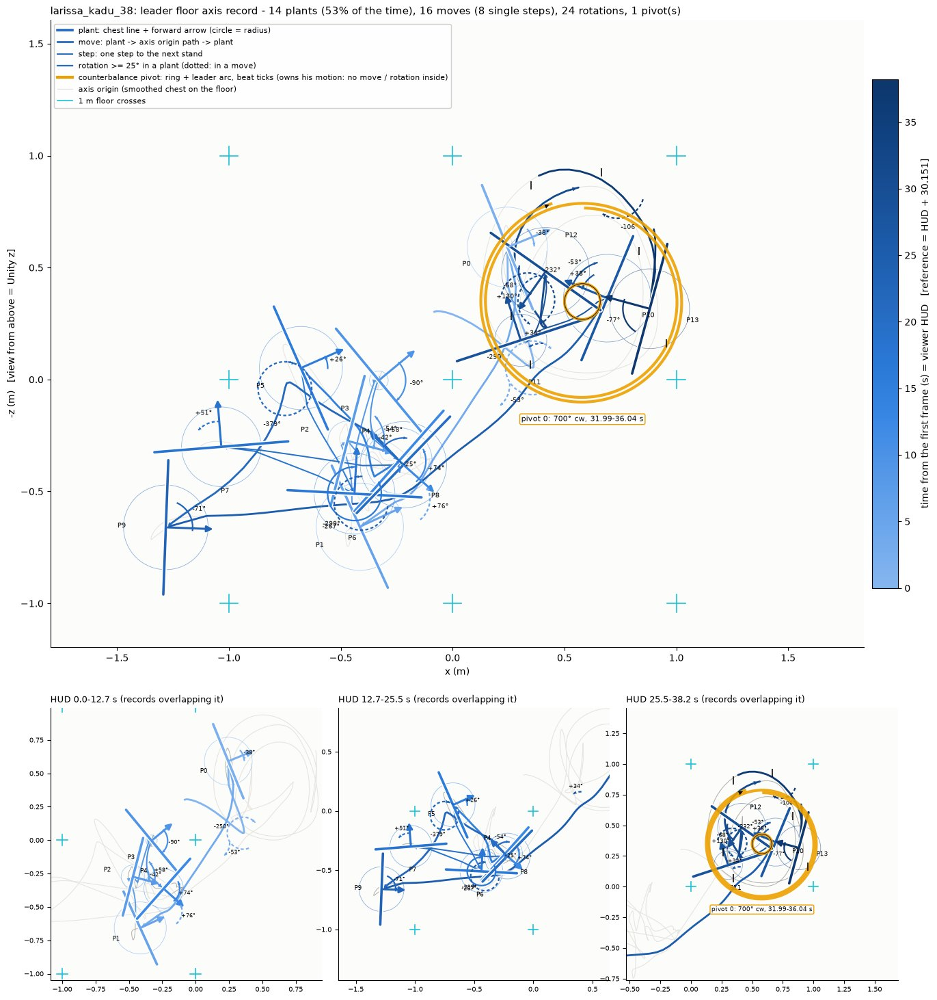

# HeadMovement: partner-dance motion capture from phone video

Several phones film a partner dance; this pipeline turns those videos into metric 3D SMPL-X poses of both dancers in a model of the room, analyses their timing, physics, counterbalance, floor craft and rhythm, and exports the result to a Unity viewer for directed films, a move library and VR. The heavy computation runs on Runpod GPU pods.

<p align="center">
  
</p>

<p align="center"><sub>Overhead 3D view of one counterbalance turn in the demo take. The yellow dot is the couple's shared centre of mass; the ring and its angle (about 700 degrees) read the turn around the follow's anchored foot, estimated from the motion; the dotted line is the path of the lead's axis.</sub></p>

This is research code, written for one project and one machine. It is not packaged, and large parts of it need data, model weights and GPU pods that are not part of the repository (see [Quick start](#quick-start) and [Data, consent and licensing](#data-consent-and-licensing)).

## Contents

- [What it does](#what-it-does)
- [Results from the demo take](#results-from-the-demo-take)
- [Repository layout](#repository-layout)
- [The farm](#the-farm)
- [Quick start](#quick-start)
- [Data, consent and licensing](#data-consent-and-licensing)
- [Known limitations](#known-limitations)
- [Documentation](#documentation)
- [Credits](#credits)

## What it does

The input is a set of handheld or tripod phone videos of one dance (any phone format, variable frame rate, optionally a clean studio track of the song). The output is a "capture": per-frame SMPL-X poses of the two dancers on a common 30 Hz time grid and in one metric world frame, the beat grid, and the analyses, in the format the Unity viewer reads.



<sub>Blue stages run locally (orchestration and light CPU work), orange stages run on Runpod pods, green is the Unity viewer. The authoritative stage list, with dependencies, outputs and measured run times, is in [dancecap/docs/PIPELINE.md](dancecap/docs/PIPELINE.md).</sub>

1. **Ingest and sync.** Frames are decoded once into a canonical store; each phone's audio is fitted to a reference clock (an affine fit per camera), so every per-frame record carries a reference time. The beat grid of the song is computed with beat_this.
2. **Camera and room model.** With the people masked out, structure-from-motion on the static room recovers each phone's pose and zoom per frame; gravity, floor and metric scale (from the dancers' stated statures) fix the world frame. Handheld and zooming phones are handled per camera type.
3. **People and identity.** Every person is detected; the couple is separated from spectators and labelled lead and follow in every camera; SAM 2.1 gives per-dancer masks.
4. **MAMMA multi-view fit.** [MAMMA](https://github.com/cuevhv/mamma) fits SMPL-X bodies to the synchronised views. The dance is cut into overlapping chunks (30 s cores by default; a take can ask for longer windows), fitted on pods, refined, and stitched at the seams with a per-joint seam gate.
5. **Analyses.** Foot touchdowns and joint accents against the beat grid; centroidal physics (centre of mass, balance margin, beat impulses); counterbalance turns; the lead's floor-craft record; a rhythm-entrainment estimate; ASR and diarization of the class audio for lesson recordings.
6. **Capture export.** Poses, timing, physics, floor-craft and move triggers are written as a Unity capture.
7. **Viewer.** The Unity viewer plays captures back (floor patterns, tension and compression, move graph, rhythm HUD), renders directed vertical and horizontal films, and has a VR build. It lives in its own repository.

## Results from the demo take

The images below come from the demo take, a three-minute professional zouk demonstration filmed by eight phones in a dance studio. They are shown with the artists' approval (see [Credits](#credits)). Captions say what each view is and, where it matters, what is estimated.

<table>
  <tr>
    <td valign="top" width="33%">
      <br>
      <sub><b>Phone video to skeleton.</b> A frame from one of the phones with the fitted skeletons projected back into the image (lead blue, follow pink): the reprojection check of the 3D fit.</sub>
    </td>
    <td valign="top" width="33%">
      <br>
      <sub><b>The eight phones.</b> The recovered camera positions around the dancers, from the static features of the room (still from the demo film).</sub>
    </td>
    <td valign="top" width="33%">
      <br>
      <sub><b>Counterbalance.</b> The follow's anchored foot, the shared centre of mass and the lead's step around her, labelled in the demo film. The turn angle is estimated from the motion.</sub>
    </td>
  </tr>
  <tr>
    <td valign="top" width="33%">
      <br>
      <sub><b>Physics view.</b> Skeleton segments coloured by estimated tension (orange) and compression (blue), plus each dancer's balance line. A kinematic estimate from the motion, not a measured force.</sub>
    </td>
    <td valign="top" width="33%">
      <br>
      <sub><b>Move graph.</b> The vocabulary of zouk moves as a graph; the dance is drawn as a path through it. The move labels are draft matches, not a validated classifier.</sub>
    </td>
    <td valign="top" width="33%">
      <br>
      <sub><b>Rhythm.</b> Each foot touchdown lights a ring on the floor, coloured by how close it fell to the beat grid computed from the song.</sub>
    </td>
  </tr>
</table>

<p align="center">
  
</p>

<p align="center"><sub><b>Floor craft.</b> The lead's floor-axis record for the 38-second analysis window of the demo, seen from above: plants (chest line and forward arrow), moves between them, rotations, and the counterbalance pivot ringed in orange (700 degrees clockwise).</sub></p>

## Repository layout

```
atlas_bridge/        early prototype: audio sync of phone videos, rig and capture export (kept as history)
dancecap/
  dancecap/          the Python package: pipeline stages, the farm, analyses, films
    pipeline/          stage registry, orchestrator, the Pipeline Monitor (local web UI)
    farm/              Runpod farm: chunks, world package, volume, pods, watcher
    cameras/           room SfM, per-frame localisation, zoom and handheld handling
    moves/             move graph, features and labels
    speech/            ASR and diarization of class audio
    dancer_splats/     avatar-guided Gaussian splats of the dancers (experimental)
  docs/              design notes and contracts, indexed in dancecap/docs/README.md
  takes/             one TOML config per recording (see Quick start)
  taxonomy/          the zouk move graph, trigger rules, Portuguese terminology
  worlds/            world-package manifests (hashes and paths only)
  remote/            shell scripts that set up a pod
  tests/             pytest suite
  CONTRACTS.md       data contracts of every stage
prototype/           NoPo4D experiments from the start of the project (rejected by their own quality gate)
tools/               commit-guard hooks (githooks/) and the Windows launcher of the Pipeline Monitor
docs/images/         the images in this README
```

The Unity viewer is a separate, public repository: [atonalfreerider/head-movement](https://github.com/atonalfreerider/head-movement) (MIT). It reads the captures this pipeline writes. Footage, weights, body models, captures and run outputs are not in this repository (`dancecap/work/` is git-ignored on purpose).

## The farm

Pose fitting for a whole dance is too heavy for a desktop PC, so it runs on Runpod. A persistent network volume holds the environment, weights, code, the world package (the solved room model, avatars and skeleton configuration shared by every analysis) and the inputs, so a pod starts from the volume and is working within minutes instead of installing everything again. The dance is cut into chunks; several pods can solve different chunks at the same time; a watcher polls the pods, pulls each verified result as soon as its chunk finishes, and the stitcher joins the chunks. The Pipeline Monitor shows the state as a defragmentation-style map: one square per second of the dance, complete, partial or not done.

Cost is kept visible: runs are estimated before they start, the monitor never creates a pod by itself, and farm pods are armed with a deadline after which a kill switch stops them. The full contract, including the commands, is in [dancecap/docs/FARM.md](dancecap/docs/FARM.md). Running it needs a Runpod account and API key (the key is read from a file outside the repository, never committed).

## Quick start

The code was developed on Windows 10 with Python 3.11 (heavy stages run on Linux pods). There is no installable package or requirements file; the stages import their own dependencies when they run.

**Run the tests that need only NumPy.** Install `numpy`, `scipy` and `pytest` in a virtual environment, then from the `dancecap/` folder:

```bash
cd dancecap
python -m pytest tests/test_timing.py tests/test_physics.py tests/test_floorcraft.py \
                 tests/test_rhythm.py tests/test_counterbalance.py tests/test_beats.py -q
```

Tests that read real take data or outputs skip themselves when that data is absent; modules that import OpenCV, PyTorch or other heavy dependencies need those installed.

**Command-line entry points** (run from `dancecap/`; every sub-command has `--help`):

```bash
python -m dancecap.pipeline status <take>        # which stages are done, running, blocked for a take
python -m dancecap.pipeline monitor              # the Pipeline Monitor, a local web UI
python -m dancecap.farm --dance <name> status    # world, coverage, chunks, pods, spend, watcher
python -m dancecap.rhythm run <take>             # rhythm-entrainment analysis of a take with a beat grid
python -m dancecap.rhythm selftest               # synthetic check of that metric
```

**Takes.** A take is one recording, described by `dancecap/takes/<take>.toml`: the footage folder (`source_dir`), the audio clocks (`alignment`), the analysed `window`, `[dance]` metadata (level, category, song, artist), the two dancers (`[dancers.lead]`, `[dancers.follow]`: name, stature, description used for the lead/follow labels) and one `[cameras."<id>"]` block per phone (handheld or tripod, zoom or not). Outputs go to `dancecap/work/<take>/`, whose file formats are defined in [dancecap/CONTRACTS.md](dancecap/CONTRACTS.md). The demo take is `larissa_kadu_full.toml`; it points at footage that is not in this repository, so a new capture needs its own take file and videos.

**Not included, and you must obtain yourself:**

- the SMPL-X, FLAME and MANO body models (each has its own licence that forbids redistribution; register and download them from the authors);
- model weights (MAMMA, SAM 2.1, YOLO, RTMW, the speech models and so on) and the MAMMA code itself, which is cloned separately;
- the footage, audio, renders, avatar textures and 3D captures of any take.

The commit hooks in `tools/githooks/` (see [dancecap/docs/GIT.md](dancecap/docs/GIT.md)) refuse most of these classes of file, so they cannot be committed by accident.

## Data, consent and licensing

- **Non-commercial research.** The project is non-commercial research. MAMMA and the SMPL-X family are released for non-commercial scientific use, and the pipeline inherits that restriction.
- **Dancers' permission.** The people in the footage are real dancers. The demo dancers agreed to a non-commercial demonstration, and the images in this README are the public demo images, used with the artists' approval. Footage, soundtracks, renders, textures, avatars and splats (all of which carry a likeness or a copyrighted recording) are deliberately not in the repository. Do not use this pipeline on people's recordings without their permission.
- **Third-party components keep their own licences.** The pipeline drives or calls: [MAMMA](https://github.com/cuevhv/mamma) (Max Planck Institute for Intelligent Systems, non-commercial scientific-research licence), SMPL-X, FLAME and MANO (MPI body models), SAM 2.1, Ultralytics YOLO, RTMW / RTMPose (through rtmlib), [beat_this](https://github.com/CPJKU/beat_this), faster-whisper, NVIDIA NeMo speech models (Parakeet, Canary, Sortformer), MoGe, COLMAP, ALIKED and LightGlue. Read the licence of each project before you use or redistribute it; this repository grants nothing on their behalf.
- **This repository's own code.** There is no licence file here yet, so no reuse rights are granted by default. The Unity viewer repository is MIT-licensed.

## Known limitations

- **Hands are raw MAMMA output.** The hand-refinement stages were retired; fingers are whatever the multi-view fit produced.
- **Single-camera takes are depth-ambiguous.** With one phone the pelvis depth comes from where the feet meet the floor plane and from the stated stature, and the body fit only starts from that guess. Treat such takes as less reliable than multi-view ones.
- **Timing is approximate.** Foot touchdown times carry roughly 0.05 to 0.2 s of detection noise, and the phones' audio-to-video offsets are not pinned better than about 30 ms, which shifts absolute phase against the beat grid by that much.
- **The rhythm score is an estimate, not a judge's score.** It measures how strongly body sway and footfalls are phase-locked to the beat grid, with its reference level calibrated on one professional demonstration. Nothing maps it to judges' scores, steady offsets from the beat are invisible to it by design, and takes shorter than about 90 s cannot be classified reliably ([dancecap/docs/RHYTHM.md](dancecap/docs/RHYTHM.md), section "Limits").
- **Physics is kinematic.** Body masses come from mesh volume at an assumed density, partner force is not identifiable from motion alone, and tension and compression are estimates.
- **Move labels are drafts.** No library classifies zouk moves; the graph and labels come from the vocabulary and the teachers' narration, not from a validated classifier ([dancecap/docs/MOVES_RESEARCH.md](dancecap/docs/MOVES_RESEARCH.md)).
- **Appearance is stylised.** Avatar textures, hair and face shape are reconstructions for the viewer, not scans.
- **Accuracy numbers are consistency measures.** The figures in the docs are reprojection errors and cross-checks; the repository holds no marker-based motion-capture ground truth (the synthetic test take has known ground truth).

## Documentation

All design documents are indexed, one line each, in [dancecap/docs/README.md](dancecap/docs/README.md). The ones to start with:

- [dancecap/docs/PIPELINE.md](dancecap/docs/PIPELINE.md): the stages, dependency graph and optimal order.
- [dancecap/CONTRACTS.md](dancecap/CONTRACTS.md): data contracts, conventions and file formats.
- [dancecap/docs/FARM.md](dancecap/docs/FARM.md): the Runpod farm.
- [dancecap/docs/RHYTHM.md](dancecap/docs/RHYTHM.md): the rhythm-entrainment estimate and its limits.
- [dancecap/docs/SPEECH.md](dancecap/docs/SPEECH.md): class speech recognition and diarization.
- [dancecap/docs/GIT.md](dancecap/docs/GIT.md): what may be committed, the hooks, the commit conventions.

## Credits

The demo take shows the dancers **Larissa** and **Kadu**, filmed by the class on their phones, dancing *Ficar Sem Você* (feat. Urias) by Davi Sabbag, as recorded in the take configuration (`dancecap/takes/larissa_kadu_full.toml`). The song itself is not part of this repository. Thanks to them for agreeing to the demonstration and to the artists for approving the use of these images.

Built on the work of the authors of MAMMA, SMPL-X, SAM 2, beat_this and the other projects listed above.
