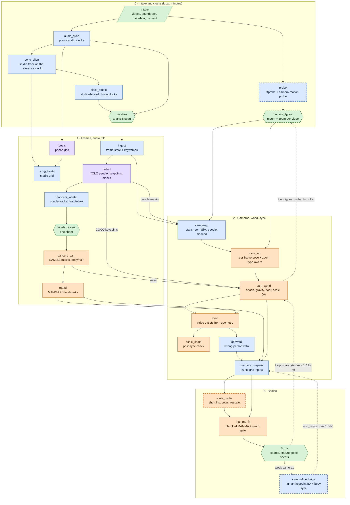
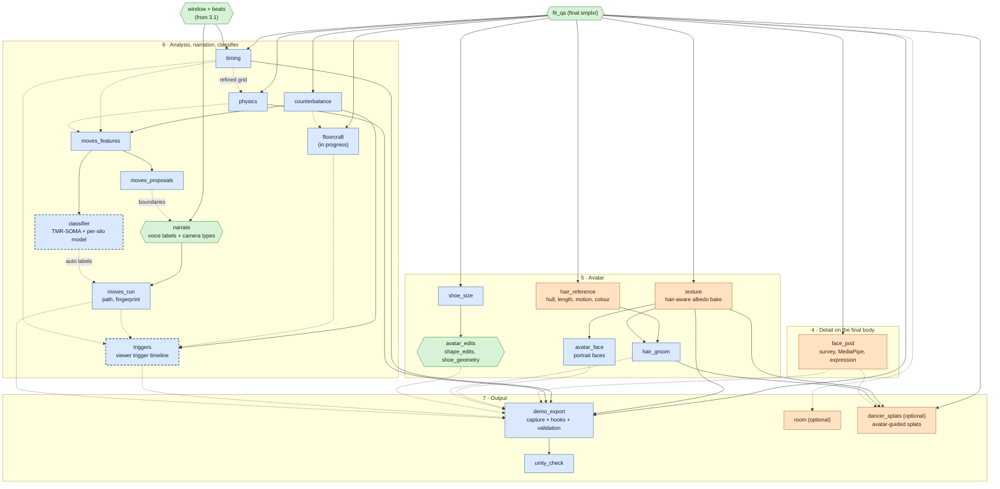
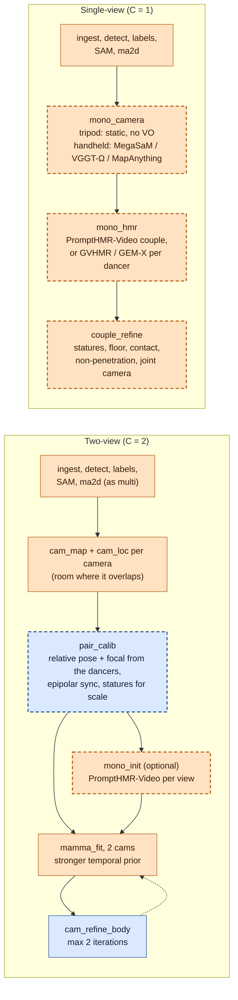

# dancecap pipeline: stages, dependency graph and optimal order

Canonical spec of the end-to-end pipeline, from a new capture (videos + soundtrack + take metadata) to the Unity
capture, the narrated move labels and the classifier-driven viewer triggers. It covers multi-view (3 or more cameras),
two-view and single-view captures, and the per-video **camera type** (handheld or tripod, zoom or not).

The machine-readable draft is `dancecap/dancecap/pipeline/stages_draft.json`, with the same stage ids. It holds the
stage id, deps, where each stage runs, the CLI, outputs, done-markers, progress sources, the estimate model, gates and
the camera-type behaviour. The pipeline backend and the Pipeline Monitor read it.

Status words used below:
- **exists**: implemented and run on real data.
- **partial**: the core exists; the part named here is not built yet.
- **in progress**: being built by another workflow.
- **new**: proposed here, not built.
- **future**: waits on a user decision (budget, licence or approval gate).

Data contracts stay in `dancecap/CONTRACTS.md`; this file only names the files.

> **2026-10-21: one entry point.** `python -m dancecap.pipeline analyze <folder|video> [--take NAME] [--dry-run] [--yes]`
> classifies the input (one video = the monocular route, a folder = multi-view), creates or reuses the take, plans the
> CURRENT routes (the volume farm for multi-view, the mono4d route for one phone; not the S1/S2 registry route below) with
> Runpod for every heavy step, prints cost and ETA, runs the generic steps and tracks the take-specific ones in the
> Pipeline Monitor (docs/PIPELINE_MONITOR_GUIDE.md 0.1, docs/PIPELINE_EFFICIENCY.md 7b).

Measured numbers come from larissa_kadu (6 s) and larissa_kadu_38 (38.4 s, 8 cameras). Sources are
`work/runpod/sessions/*/state.json`, `work/runpod/ledger.json`, `work/larissa_kadu_38/front/front_pod.json`,
`mamma/chunks*.json`, stage logs and reports. Anything not measured is labelled *estimate*.

---

## 1. Summary: the optimal order

1. **Intake and probe (local, minutes).**
   - Videos, soundtrack, metadata (level, category, song, dancers with role, stature and shoe sole, consent) and
     the per-video camera type.
   - The probe pre-fills the camera type from the video itself (section 4.2). The user confirms it.
2. **Clocks first (local, minutes).**
   - Steps: phone audio clocks, then the studio track, then studio-derived clocks, then the analysis window.
   - Every per-frame record carries reference time `t`, and ingest decodes only the frames inside the window. A
     clock or window change after ingest invalidates everything, so this step must come first.
3. **2D per camera, in parallel.**
   - Order: ingest, detect, lead/follow labels (human check of one sheet), SAM 2.1 masks, then ma_2d landmarks.
   - The people masks must exist before any static-scene geometry, because moving people break SfM.
4. **Cameras from the static room, before any body.**
   - Steps: SfM with people masked, then per-frame localisation (type-aware), attach, then gravity (from the
     building), floor (from the ankles) and metric scale (statures).
   - Static points are many, precise and time-independent, so the cameras do not need video sync yet.
5. **Video sync, after cameras and ma_2d, before the body fit.**
   - It needs calibrated cameras to triangulate the dancers.
   - Bodies need it: at 2 m/s, 50 ms is 10 cm.
6. **Wrong-person veto, then MAMMA prepare.**
7. **Coarse body, then scale, then full body.**
   - Short spread chunks fit the betas first, and the stature check rescales the world if needed (new).
   - Then the full chunked MAMMA fit runs. This avoids a full refit when the scale is 1.5 % off.
8. **Bodies refine the weak cameras (new).**
   - Human-keypoint bundle adjustment plus body-based residual sync, only where the room was weak: attached
     cameras, zoomed cameras, two-view.
   - At most one refit for multi-view, two for two-view.
9. **Detail on the final body.**
   - Face (expression), texture bake, hair reference and groom, and shoe size.
   - All of them read `smplx/`, so they run after the last refit. They are independent of each other: batch them on
     the pods.
   - Hands refinement (hand detectors, WiLoR/HaMeR, fingers, contact; `smplx_hands/`, `smplx_detail/`) was retired
     by the user on 2026-10-07: about 10 h for the hand analysis plus 8 h for the build on larissa_kadu_full. The
     pipeline no longer runs it, and the export plays the take's normal motion.
10. **Analyses (local CPU).**
    - Timing, then physics; counterbalance; floor craft; then features and proposals.
11. **Narration and classifier.**
    - The narration tool needs only the videos, the reference clock and the beat grid. Start it right after the
      clocks, in parallel with all pod work.
    - Proposals and counterbalance enrich it later. Camera types can also be confirmed there.
12. **Triggers, then export, then Unity.**
    - Classifier and analysis intervals become viewer triggers (new).
    - `demo_export` writes the capture and re-runs every add-on hook.
13. **Leaves (optional).** The room splat (hidden by default) and the avatar-guided dancer splats
    (`dancer_splats`, built 2026-10-08: dancers only, viewer layer off by default; its own pod session S_splats).

Where it runs: local means orchestration, UI, light CPU checks and short jobs on the shared 2080 Ti. Everything
heavy runs on Runpod in a few batched sessions (section 7):
- **S1 front**: SAM, localisation, ma_2d, cameras, sync, prepare.
- **S2 fit**: scale probe, MAMMA, texture bake, face and hair hull.
- **S_room** (optional): the static room splat.
- **S_splats** (optional): the avatar-guided dancer splats (one short window; $1.50 per session, user approval
  2026-10-08).

(The former **S3 hands** session was retired with the hands steps on 2026-10-07.)

The monitor never creates a pod by itself.

---

## 2. Inputs (the new-capture wizard writes `takes/<take>.toml`)

| Input | Where | Notes |
|---|---|---|
| Source videos | `source_dir` | Any phone format. Variable frame rate (never assume a constant fps). Rotation metadata is applied at ingest. One recording per camera id `01..NN`. |
| Soundtrack (optional) | `[dance] song_file` | Gives the studio clocks (±1-2 ms) and the studio beat grid. Copyrighted: stays under `work/`, never in a repo. |
| Dance metadata | `[dance]` | `level` (professional, intermediate, novice), `category` (demo, lesson, jack_and_jill), `song`, `artist`. Data is siloed by level. |
| Dancers | `[dancers.lead]`, `[dancers.follow]` | `name`, `pid` (1 = lead, 2 = follow), `stature_m` (sets the metric scale), `shoe_sole_m` (default 0.025, assumed), `description` (colour cues for the labels), optional `portrait`, `mass_kg`, `shoe_geometry`, `shape_edits`. |
| Consent | `[consent]` (TMR_SOMA_PLAN G0) | Must be recorded before any pod upload of dancer data. |
| Camera types | `[cameras."<cam>"]` | See section 4. Pre-filled by the probe, confirmed by the user. |
| Clocks and window | `alignment`, `window`, `keyframe_span`, `keyframe_step`, `exclude` | Written by the clock stages. |
| Options | `[sync] required`, `[cameras] scale_rule`, `scale_reference`, `loc` | As today. |

---

## 3. The dependency graph

Legend:
- Blue: local CPU. Purple: local GPU (2080 Ti, `work/gpu.lock`). Orange: Runpod pod. Green: human.
- Dashed border: new or future.
- Dotted arrows: optional or soft inputs, and iteration loops.

### 3.1 Front half: from intake to the first body fit (multi-view)



### 3.2 Back half: detail, analysis, narration, triggers, export



Notes on the back half:
- **No hands stages (retired by the user, 2026-10-07).** `hands_survey`, `hands_pod` and `hands_build` (session
  S3_hands) are gone from the registry, the plans and the estimates. Nothing downstream reads `hands/`,
  `smplx_hands/` or `smplx_detail/`: the texture bake reads `smplx/`, and `demo_export` plays the take's normal
  motion (`takes/<take>.toml [export] smplx_dir`, else `smplx/`). The hands modules stay in the repo, unreferenced.
- **Shoes is not a node.** `shoes` needs the exported skins, so it runs as a `demo_export` hook, like
  `hair_groom --export-only`, `face_export`, the counterbalance export, the floorcraft export, the moves export
  and the new triggers export.

### 3.3 Two-view and single-view variants



After `fit_qa` or `couple_refine`, both variants continue with the back half (3.2). Some parts are weaker there:
- A single view textures one side of each dancer; the mirror and diffusion fill does the rest.
- Faces get far fewer views.

---

## 4. Camera types (user input + automatic suggestion)

### 4.1 Contract (take TOML)

```toml
[cameras."01"]          # one table per source id; sits beside [cameras] scale_rule / scale_reference / loc
mount = "handheld"      # handheld | tripod                 (user)
zoom = false            # true | false (independent: a tripod can zoom)   (user)
source = "user"         # user = confirmed | auto = suggestion, not confirmed yet
# written by the probe, kept for the record; never overrides the user:
suggested = { mount = "handheld", zoom = false, pans = true, confidence = 0.93, by = "probe_b", at = "2026-10-07T18:00:00Z" }
pans = true             # tripod only, automatic: the head pans/tilts (rotation varies, centre fixed)
zoom_events = [[35.6, 36.4, 0.64]]   # automatic: [t0, t1, focal ratio] in reference seconds
```

- **Reading.** Only `scale_rule`, `scale_reference` and `loc` are read under `[cameras]` today (`world.py`,
  `world_scale.py`, `cameras/pipeline.py`, `front_pod.py`), and camera ids are two digits, so the per-camera
  sub-tables cannot collide. Code should read them through one helper (e.g. `take.camera_type(cam)`).
- **Writing.** The take TOMLs are heavily commented. Writes must preserve comments (`tomlkit`, or a line editor),
  never `tomllib` plus a dump.
- **Default when missing:** handheld with zoom, the most general model and exactly today's solver. A take without
  camera types behaves as now. Types only add constraints.
- **Precedence: the user wins.** When the data contradicts the user (a "tripod" whose centre moves 10 cm), the
  `camera_types` gate reopens with the evidence. The pipeline never silently overrides the user.
- **Where it is entered:**
  - the monitor's new-capture wizard, pre-filled by the probe;
  - a per-take video review screen in the monitor;
  - the narration tool (`python -m dancecap.moves annotate`), as a camera panel next to the camera picker;
  - all three write the same TOML keys.
- **Changing a type later** marks `cam_map` and `cam_loc` of that camera, and everything downstream, stale.

### 4.2 Automatic suggestion

The suggestion runs twice. Both probes are new code.

**Probe A, before calibration** (stage `probe`, local CPU, about 30 s per video):
- Background homographies at 10 Hz on 480p grey frames. People boxes are masked once `detect` exists; before
  that, RANSAC treats the dancers as outliers.
- It measures:
  - **parallax**: does a rotation-only model explain 1 s frame pairs as well as a fundamental matrix? If not, the
    camera translates, so it is handheld;
  - **jitter**: 2-12 Hz energy of the background motion (hand tremor and sway);
  - **zoom**: the cumulative similarity scale after rotation compensation.

**Probe B, after calibration** (proposed as an additive output of `cam_world`:
`probe/camera_types_probe_b.json`). It reads
`cameras/<cam>.npz` in world metres:
- camera-centre deviation p95 from the video's median;
- optical-axis angle p95;
- angular velocity p50;
- focal p95/p5 and focal steps.

Thresholds (first proposal, to tune on more takes):

| Suggest | Rule |
|---|---|
| tripod | centre deviation p95 < 0.02 m and angular velocity p50 < 0.3 °/s outside pans |
| handheld | centre deviation p95 > 0.05 m, or angular velocity p50 > 0.5 °/s with 2-12 Hz jitter |
| pans (tripod) | axis angle p95 > 0.3° |
| zoom | focal p95/p5 > 1.05, or a focal step > 3 % within 0.5 s |
| uncertain | between the bounds, so confidence < 0.7: the gate blocks the camera stages for that camera only |

**Cameras attached rotation-only** (larissa_kadu 05 and 06) have a centre that is constant *by the model*. Probe B
cannot judge their mount, so only probe A counts for them.

Check against larissa_kadu_38 (probe B values computed from today's `cameras/*.npz`; all were handheld phones):

| Cam | Centre p95 | Axis p95 | Ang. vel. p50 | Focal p95/p5 | Suggestion |
|---|---|---|---|---|---|
| 01 | 0.112 m | 11.3° | 1.5 °/s | 1.00 | handheld, no zoom |
| 02 | 0.112 m | 14.2° | n/a | 1.00 | handheld, no zoom |
| 03 | 0.053 m | 7.0° | n/a | 1.00 | handheld, no zoom |
| 04 | 0.049 m | 11.2° | 1.0 °/s | 1.59 | handheld (borderline centre), zoom: one step 1.45 to 0.93 f/maxdim near 36 s |
| 05, 06 | by model | 8-9° | 1.1 °/s | 1.00 | attached rotation-only: probe A only |
| 07 | 0.178 m | 5.3° | 1.0 °/s | 1.12 | handheld, zoom: one step 0.86 to 0.97 near 38-40 s |
| 09 | 0.223 m | 12.1° | 2.1 °/s | 2.16 | handheld, zoom: continuous 0.96-2.10 (the zoom-depth guard case) |

Phones with electronic stabilisation (EIS) crop and warp per frame. A "no zoom" handheld phone therefore keeps a
*tight prior* on its intrinsics, not a hard constraint (section 4.3).

### 4.3 How each stage uses the type

Notation: T = tripod, H = handheld, z = zoom, nz = no zoom.

| Stage | T, nz (pans = false: locked) | T, z | H, nz | H, z (default: today) |
|---|---|---|---|---|
| ingest | Keyframes: 2-3 sharp frames suffice (one viewpoint). | Keyframes at each zoom level. | As today. | As today. |
| cam_map | 2-3 images, ONE COLMAP camera (shared K, k1). Post-BA check that their centres coincide within 2 cm. **Tripod images register first and anchor the gauge.** | Images per zoom level, shared centre; rotation-only self-calibration of the focal. | Images every ~0.67 s; ONE COLMAP camera per video (shared K, k1). | One COLMAP camera per image. |
| cam_loc | Localise ~1 frame per 2 s plus the sharpest frames; robust mean pose. A change-point test on the static background splits a bumped tripod into constant segments. With pans: centre fixed, per-frame rotation only (3 dof, homography chain to reference frames). **Cost ~0.05 locked, ~0.3 with pans.** | Centre fixed; per-frame rotation + focal (4 dof) from homographies to reference frames. **Zoom-depth guard off: with the centre known there is no axis ambiguity.** Cost ~0.3. | Per-frame 6-dof P3P with the video's fixed K and k1 (no P4Pf race). Weak focal freedom only if EIS drift > 1 %. Cost ~0.8. | P4Pf vs P3P race, log-focal smoothing, zoom-depth guard. Cost 1.0. |
| smoothing | None (constant per segment). Rotation smoothing with pans. | Rotation + log-focal, zoom events kept sharp. | Local-linear, sigma 0.04 s; focal constant. | As today. |
| cam_world: attach | No static links? Then one constant (R, C) per segment from the dancers over the whole video: 6 dof against thousands of frames, well posed. | Same; rotation and focal from the homographies. | Sub-model + Sim3 / rotation-only variants with temporal hold-out. | As today. |
| cam_world: gravity, floor | Tripod verticals weighted ×2: no hand shake, stable horizon, median over the whole take. A constant camera height is a floor check. | Same. | As today. | As today. |
| sync | Only the time offset varies in time, so curves are cleaner. Tripods are preferred triangulation sources for the other cameras. | Same. | As today. | As today. |
| mamma_prepare | Constant cam_ext (no resampling noise). | Per-frame K. | Per-frame pose, constant K. | Per-frame pose + K. |
| cam_refine_body | 6 dof (+ focal) per constant segment over the whole take: the strongest case. Always run for tripods that attach via the dancers. | Constant centre + per-frame rotation/focal spline. | Low-frequency pose spline correction (knots every 0.5 s). | Pose + log-focal spline (knots every 0.25 s). Priority camera. |
| room | A locked tripod adds ONE viewpoint; an all-tripod rig gives a weak room. | Several FOVs, one centre. | Good parallax. | Good parallax. |
| two-view (pair_calib) | T+T: 12 unknowns + 2 focals over thousands of body correspondences; classic stereo calibration from people; robust epipolar sync. | T+Hz: the tripod defines the world; the zoomed handheld gets a per-frame focal. | H+H: each camera's own SfM/VO + one Sim3 per camera from the bodies. | As H+H, with a per-frame focal from VO. |
| single-view (mono_camera) | No VO at all (GVHMR-style static-camera flag). K from vanishing points or the dancers' statures. | Rotation + focal from background homographies; no translation. | VO with known fixed K: MapAnything takes intrinsics as input; MegaSaM. | VO with per-frame intrinsics (VGGT-Ω / MapAnything). Lowest confidence: wider QA bands. |

The table is the design; section 4.4 says which cells are built. Effects on **ordering** (planned, not built yet:
today the type changes the camera solve after localisation, not the order of the stages):
- With one or more tripods, the static map is built from the tripod views first; the handheld cameras then localise
  against them.
- With two or more tripods that overlap, a body-based tripod calibration can run right after `ma2d`, before the
  handheld localisation. It gives an early triangulation of the dancers, which helps `attach` and `sync`.
- An all-tripod rig skips per-frame localisation almost entirely. S1 then becomes SAM and ma_2d bound, roughly 40 %
  of today's work.
- A single tripod view skips VO.

Effects on **QA gates** (each conflict opens the `camera_types` gate with the evidence):

| Type | Gate | Conflict means |
|---|---|---|
| Tripod | centre drift p95 < 2 cm; background jitter < 0.05° per frame | Bumped tripod (gets segments) or wrong type |
| No zoom | focal p95/p5 < 1.02 | Zoom, lens switch or EIS |
| Zoom | depth-guard recentred fraction and post-refine focal steps | Reported |
| Any | static reprojection median < 4 px | As today |

Effects on **ETA and cost**: localisation is the largest front-end cost (about 22 task-minutes per CM, measured; CM
is defined in section 7). The estimate model applies the IMPLEMENTED factors to `cam_loc`
(`pipeline/camtypes.LOC_FACTOR`): only a locked tripod is localised on keyframes (one frame pair per 2 s + the map's
frames: ~0.1; p90 1.1, when the keyframes refuse the constant pose and every frame is localised after them); every
other class localises every frame (1.0) - the 0.3 / 0.8 factors of the table need the homography and fixed-K
localisers, which are not built. A rig of 4 locked tripods plus 4 handheld phones would cut the S1 localisation work
by roughly 45 % (*estimate*; SAM and ma_2d unchanged).

### 4.4 Implemented (2026-10-07)

- `dancecap/camera_types.py`: the TOML contract (owned blocks, etag, backups with millisecond names, never
  overwritten), CameraType JSON (+ `model_check`: what the last cameras run did with the type), the stage policy
  (`user` = confirmed answers only, the default of the CLI, the pod jobs and the orchestrator; `auto`; `off`), probe A
  (`suggest_from_video`: background motion windows + a whole-video keyframe zoom scan) and probe B (`probe_b`: today's
  general per-frame tracks; an attached camera's centre and focal are fixed by the attach model, so probe B gives no
  mount / zoom verdict for them and never a conflict). Below the confidence bar a measured 'tripod' pre-fills
  handheld (the prior; `mount_lean` keeps the lean). CLI `python -m dancecap.camera_types show|suggest|set|accept|clear
  <take>`. Contract: CONTRACTS.md "Camera types".
- `dancecap/cameras/typed.py`: the models of 4.3 for `cam_loc` / smoothing (one focal per video; one constant tripod
  pose with keyframe localisation; shared centre with per-frame rotation for pans and tripod + zoom). The joint fits
  use subsets; the final per-frame solves use every correspondence. Each model is checked against today's per-frame
  solution: static reprojection, a translation-drift check for the fixed-centre models (on keyframes with the pair
  noise taken out, so it decides like the every-frame check), a focal check for a fixed focal and a jitter check
  (centre and rotation jitter <= 1.25 x today's + a small floor). A refused model keeps a safer model, is reported in
  report.json `cams.<cam>.camera_type` and shown as a warning next to the answer (narration tool, monitor; summary
  `refused`); probe B opens the camera_types gate when its measurement contradicts the answer.
- Keyframes-only localisation is recorded (`loc_<cam>.npz` `loc_mode` / `loc_class` / `loc_policy` /
  `loc_localised`, report.json `camera_types.localised`) and is valid for the constant pose only: a type or policy
  change refuses `cameras` runs without `loc` (`KeyframeCacheError`, before any work) and stage_smooth never exports
  such a track; the Runpod front session never splits a locked tripod into parts (one decision per camera).
- Not built: `cam_map` (one COLMAP camera per video, tripods first), the world-frame / gravity weighting of tripods,
  homography / fixed-K localisers (the 0.3 / 0.8 cost factors), tripods as preferred sync sources.
- Narration tool camera panel: `GET/PUT/DELETE /api/cameras/types[/<cam>]`, `POST /api/cameras/types/accept` (JSON
  only; cross-site writes refused).
- sync (`offsets.json camera_models`) and MAMMA prepare (`prepare.json camera_types`) record the models; a constant
  track already resamples to one `cam_ext`, so nothing else changes there.
- The monitor's stale check compares with the class under the policy each cameras run recorded.
- Thresholds measured on larissa_kadu / larissa_kadu_38 (all handheld phones): the drift guard and probe A/B bounds
  are still uncalibrated for real tripods; recheck them on the first tripod capture
  (`python -m dancecap.camera_types suggest <take> --probe a --rescore` re-scores stored probe-A evidence).

---

## 5. Stages: where they run, inputs and outputs, estimates, parallelism, gates, retry

Units and rates:
- **V** = video minutes in the window. **C** = cameras. **CM** = camera-minutes at 30 fps equivalent (canonical
  frames / 1800; a 59.94 fps camera counts twice). **T** = 30 Hz grid frames (1800 × V).
- larissa_kadu_38: V = 0.64, C = 8, CM = 5.76 (9 CM per video-minute).
- Rates: A100 community $1.39/h, secure $1.59/h; A40 secure $0.49/h.
- Pod rates marked "work" are summed over parallel tasks. Wall time ≈ work / concurrency, bounded below by the
  slowest single task.
- Full CLI strings, outputs and done-markers are in `stages_draft.json`.

### 5.1 Intake and clocks (local)

| Stage | Exists | In → out | Estimate | Gate / retry |
|---|---|---|---|---|
| intake | new | user input → `takes/<take>.toml`, `intake.json` | human, ~5 min | Statures, roles, level and consent set; edits make descendants stale |
| probe | new | sources → `probe/probe.json`, `probe/camera_types_suggested.json` | ~0.5 min + 0.5 min/cam (estimate) | Decodable, has audio; VFR reported |
| camera_types | new | probe → TOML `[cameras."NN"]` | human, ~1 min | Blocks camera stages only for uncertain or conflicting cameras |
| audio_sync | partial: `prototype/sync_larissa_kadu.py`, to port | sources → `clock/alignment.json` (affine, 10 s anchors, fractional PHAT 300-2800 Hz) | ~1 min + 0.5 min/cam (estimate) | ≥ 5 accepted anchors per camera, residual median < 5 ms. A camera without usable audio goes to `exclude`. |
| song_align | exists | alignment + studio track → `song/song.json`, `studio_reference.wav` | ~3 min (estimate) | residual p95 < 5 ms. Optional (needs a soundtrack). |
| clock_studio | exists | song → `alignment_studio.json`, `clock_studio/validation.json` | ~2 min | Validation A-C. New takes should use these clocks: ±1-2 ms vs alignment.json's −36..+29 ms. |
| window | exists | clocks → TOML `window` (largest all-camera span) | seconds | User confirms the span (cost scales with V). Re-check after sync: `clock_studio window --take`. A new window is a new take name. |

### 5.2 Frames, audio, 2D

| Stage | Runs on | Estimate | Parallel | Gate / retry |
|---|---|---|---|---|
| ingest | local (new pod alternative: decode stream-copied source trims on the pod) | 0.5 + 0.35 min/CM (measured: 2.0 min for 5.76 CM) | Per camera | Frame count within 2 % of fps × window; t monotonic. Idempotent. |
| beats | local GPU (short) | ~2 + 0.5 min/cam (estimate) | Alongside every visual stage: needs only clocks | Stable tempo, bar phase decided |
| song_beats | local | ~2 min | – | Measure 0 matches beats.json. Preferred grid for timing (`--no-refine`). |
| detect | local GPU, or pod | Local 2080 Ti 7.7 min/CM (measured: 39 min for 5.12 CM, 160-350 ms/frame). Pod A100 ~2.7 min/CM per process (cam09: 105 s for 1151 frames). | Per camera | Dancer pair present on > 80 % of frames. Local is free and overlaps with the human's intake and narration; move it into S1 above ~6 CM. |
| dancers_labels | local | ~1 + 0.5 min/cam | Per camera | Label confidence. Override with `dancers/labels_override.json`. |
| dancers_seed (alternative) | local CPU (< 300 MB, frames streamed) | ~1 min/cam | Per camera | When a monocular take of the same footage already has eye-checked teacher tracks (lucas_luiza from lucas_luiza_h / _v): identity is mapped onto this take's own detections (`python -m dancecap.dancers_seed run <take> --map CAM=SRC:SRC_CAM:RULE`). G0 in `dancers/seed_report.json`: the rule's own frame offset is the best IoU, matched shares, role jumps. `--drop` / `--keep` after review. |
| labels_review | human | ~2 min | – | **Before SAM**: a swapped label wastes the whole front session. Proposed relaxation: when every camera's label confidence is high, S1 starts without waiting, and a later swap re-runs only that camera. |
| dancers_sam | pod S1 | Work ~10 min/CM (measured: 340-862 s per camera, ~0.33 s/frame) | 5 cameras per A100 (host RAM: a 1080p60 camera needs ~35 GB) | No identity flags; hair mask on ≥ 90 % of follow frames. Per-camera re-run; `--reuse-sam`; the supervisor re-queues OOM-killed tasks. |
| ma2d | pod S1 | Work ~6 min/CM (measured: 147-614 s per camera) | 2 at a time, each starting as soon as that camera's masks exist | Manifest mask signature. Pod landmarks mean local prepare uses `--skip-2d`. |

### 5.3 Cameras, world, sync

| Stage | Runs on | Estimate | Parallel | Gate / retry |
|---|---|---|---|---|
| cam_map | local CPU, or pod | 3 + 0.15 min/image (measured: 114 images, mapping 1032 s); roughly quadratic beyond ~150 images | – | Main model ≥ 3 cameras, < 1 px; weak cameras go to sub-models. Same recordings: reuse the map (`cameras.reuse`). |
| cam_loc | pod S1 | Work ~22 min/CM for H,z (measured: ~0.7-0.8 s/frame per process); × type factor (4.3) | 5 processes; the slowest camera split in halves | ok > 95 %, static reprojection < 4 px. Retry per camera or half. |
| cam_world | pod S1, or local CPU | 2 + 3.4 min/CM (measured: 1171 s) | – | G2a: gravity vs building < 1°, dancer leave-one-out, world_scale (dancers agree ≤ 1.5 %, SE ≤ 0.75 %, halves ≤ 2 %); probe B vs camera types. A new world frame makes `smplx/` stale (the texture refuses stale fits). |
| sync | pod S1 (`--workers 16`) | 1 + 0.75 min/CM (measured: 252 s pooled, 1567 s serial) | Process pool | Every used camera stable (2 s sub-windows within 10 ms), not at the search edge. Never copy offsets between takes. |
| sync (two cameras) | pod (`cameras.twoview sync`, CPU) | minutes | – | dancecap.sync needs >= 2 other cameras per camera: a two-camera take is synced from the dancers' COCO joints (symmetric epipolar distance, 30 s sub-windows, gauge = the tripod). Stable = sub-windows within 10 ms of the fitted line; an unstable or edge result exits 2 and never writes `use: false`. G8 in `cameras/qa/twoview_gates.json`. |
| scale_chain | pod S1 | seconds | – | chain vs world ≤ 2 % (coarse; never a reason to rescale alone) |
| geoveto | local (`--check` on the pod: 82 s) | ~2 + 0.3 min/CM | – | Human views `review/reid_veto.png` before `--apply`. Proposed: auto-apply only high-confidence runs, so S1 and S2 can chain. |
| mamma_prepare | local or pod | ~1 min | – | Refuses without this take's sync when `[sync] required`. Cheap to re-run. |

### 5.4 Bodies

| Stage | Runs on | Estimate | Gate / retry |
|---|---|---|---|
| scale_probe (new) | pod S2, first job | ~12 min (derived: 3 × 60-frame fits ≈ 675 × (0.4 s + 4.8 ms × 60) solo, × 1.6 under MPS) | Rest heights vs stature + sole within 1.5 % after the factor; apply only when both dancers agree. Skip when a verified `scale_reference` is inherited. |
| mamma_fit | pod S2 | ~75 min wall per video-minute (8 cameras), plus ~80 min when the seam gate falls back. Measured larissa_kadu_38 (T 1148): 6 chunks under MPS 47 min, merge 4 min, gate fallback full fit 53 min (follow seam p95 83 mm > 60). Model: 675 iterations × (0.4 s + 4.8 ms × frames) solo; × 2.1 for 6 side by side. | `chunks_gate`; an in-session fallback when the kill switch leaves time, else exit 3 and no bake. Proposal: cut chunks at low-motion instants on the beat grid, with 2 s overlaps, so the gate fails less often. |
| fit_qa | local + human | ~5 + 3 min/V | G3 reprojection per camera (larissa_kadu c8: 5.43 / 6.11 px); world_scale check; seams smooth. Decides cam_refine_body. |
| cam_refine_body (new) | local, or pod before the refit | ~5 + 2 min/CM (estimate) | Conditional (section 6.2); at most one refit for multi-view, two for two-view |
| mamma_loo | pod, optional | ~30 min for 6 s (7 parallel leave-one-out fits) | Camera rejected only if its held-out/in-fit ratio > 2× the others' median |

### 5.5 Detail and avatar

| Stage | Runs on | Estimate | Gate / retry |
|---|---|---|---|
| face_pod | pod S2 | ~5 + 2 min/CM (estimate in face_pod.py for 38 s: survey 5, MediaPipe 1 on 24 CPUs, expr 5) | Hold-out model selection. Frame times sync-corrected. |
| texture | pod S2 (chains after MAMMA) | views × 0.289 s + 24.7 min/V + 3, from avatar_pod rates (A100-SXM4, 2026-10-07): 0.061 s/view pass 0 + 0.114 × 2 registration passes; 15.8 min head fix / hair / fill per 1152 grid frames | Refuses stale smplx; hair masks ≥ 90 %; leave-one-camera-out MAE; `max_minutes` below the recommendation is refused |
| avatar_face | local | ~5 min | Likeness vs held-out crops; `--composite` after a re-bake |
| hair_reference | pod S2, or local GPU (~12 min for 6 s) | ~5 + 2 min/CM (estimate) | Hull consistency |
| hair_groom | local CPU | ~3 min (measured) | Roots inside the skin |
| shoe_size | local CPU | ~1 + 0.5 min/CM | Planted-foot views; MAMMA's ma_2d foot landmarks, or RTMW-x foot points with `--detect` |
| avatar_edits | human | – | `shape_edits` and `shoe_geometry` in the TOML |

The hands stages (`hands_survey`, `hands_pod`, `hands_build`: ~25 + ~20 A40-min per camera-minute, about 10 h + 8 h
for larissa_kadu_full) were retired by the user on 2026-10-07 and are no longer estimated or planned.

| Stage | Runs on | Estimate | Gate / retry |
|---|---|---|---|
| dancer_splats (optional) | prep local CPU (~3 min), train + eval on pod S_splats | 28 min on the pod (*derived*: training stops itself inside 24 min and 15 min before the kill switch, eval ~4 min); session <= 55 min / $1.50 | Deps fit_qa, texture, hair_groom (soft: face_pod; never the retired hands outputs). Held-out camera 03 + every 10th instant: PSNR / SSIM / LPIPS vs the textured avatar, IoU, ghosts, hair in the turns, temporal change (metrics.json gates); review gate on review/splats/ before any Unity export. Resumable (checkpoints + .done markers; the checkpoint comes back after a failure and `run-pod --retry` resumes on a new pod inside the approved $2 total); training stops hard at its budget and still writes model.pt. `run-pod` also runs the local export + review sheets after the download. `docs/DANCER_SPLATS_RESEARCH.md` section 12. |

### 5.6 Analysis, narration, triggers, export (local)

| Stage | Estimate (*estimate* unless noted) | Notes |
|---|---|---|
| timing | 2 + 6 min/V | Studio grid with `--no-refine` when a soundtrack exists |
| physics (+ analysis_review) | 2 + 5 min/V | Stature check within 1.5 % |
| counterbalance | 1 + 2 min/V | User truth for larissa_kadu_38: 32.0-36.15 s |
| floorcraft | 1 + 2 min/V | In progress (demo workflow): `python -m dancecap.floorcraft <take>` writes `floorcraft/floorcraft.json` (leader floor axis; plants, moves, rotations; counterbalance pivots) and re-detects counterbalance when missing. Its `--export-only --export-capture <name>` call is an export hook. |
| moves_features, moves_proposals | 1 + 3 min/V | Proposals never enter labels.json |
| narrate | human, ~6 min/V (0.5× playback) | Starts right after the clocks and beats |
| moves_run | ~1 min | Path, fingerprint, review, Unity copies |
| classifier | future | G0, G5 and G9 gates (TMR_SOMA_PLAN); per level silo |
| triggers (new) | seconds | Section 8 |
| demo_export | 2 + 2 min/V | Validation must pass; never commit SMPL-X-derived data or likeness data |

Run local CPU analyses **two at a time**: the workstation has 4 logical CPUs, and the monitor and Unity need
headroom. Local GPU stages are serialised by `work/gpu.lock`.

---

## 6. Iteration loops (how many, and when)

### 6.1 Scale: coarse body, scale, full body (`scale_probe`, `loop_scale`)

The world scale comes from the dancers' keypoint chains against their statures (`scale_rule = "chain"`, CHAIN_FRAC
calibrated on larissa_kadu). For new dances without a `scale_reference`, the chain is accurate to a few percent. The
fitted SMPL-X rest heights (stature + shoe sole) are the stronger check (`world_scale check`, tolerance 1.5 %).

On larissa_kadu, the meshes came out +6-7 % tall: the eye_p90 rule was 4.8 % too large. The fix there was a full
refit.

Proposal:
1. Fit three short 60-frame windows (20 %, 50 % and 80 % of the grid) in parallel at the start of S2, about 12 min.
2. Run the stature check on them.
3. Rescale the world when the verdict is `rescale`, then re-prepare (seconds).
4. Then run the full fit.

One iteration. A second scale loop runs only if the full fit's check still fails (rare). It invalidates `smplx/`,
timing, physics, avatar and export.

### 6.2 Cameras and bodies: who helps whom (`cam_refine_body`, `loop_refine`)

**Cameras first, from the static room**:
- The room gives hundreds of static points per frame at about 1-2 px, independent of time, so video sync is not
  needed yet.
- The dancers give about 50 landmarks per person at 5-7 px uncertainty, on articulated bodies that need sync.
- Calibrating from bodies first would fold pose errors into the cameras.

**Bodies then refine the cameras where the room is weak.** Trigger `cam_refine_body` when any of these holds:
- attached cameras (05 and 06 on larissa_kadu: yaw and centre come from COCO keypoints);
- zoomed cameras with more than 5 % depth-guard re-centred frames (cam09);
- a camera's leave-one-out held-out/in-fit ratio above 1.5× the median;
- `dancer_px` above 2× the camera's median;
- any two-view capture.

The method:
- Hold the bodies fixed; minimise robust reprojection of the fitted SMPL-X landmarks against ma_2d, plus the
  camera's static points.
- Use the per-type parameterisation of section 4.3.
- Re-measure each camera's video offset against the fitted bodies in the same step (`sync/offsets_body.json`).
  This works for attached cameras too, which today's sync never uses to triangulate.

When it is worth a refit:
- The held-out residual improves by at least 5 %.
- And the cameras moved more than 2 cm, 0.2° or 1 % focal on more than 10 % of frames, **or** any |Δ sync| > 5 ms.
  At 2 m/s, 5 ms is 1 cm.

How many iterations:
- **Multi-view: 1.** Coordinate descent from good static-room cameras converges in one step. The refit costs about
  75 A100-minutes per video-minute.
- **Two-view: 2.**
- **Single-view:** done jointly inside `couple_refine`.

### 6.3 Video sync after the first 3D fit

Today `sync` triangulates ma_2d landmarks from the other cameras. This is non-circular and needs no body model. The
studio clocks put the audio within ±1-2 ms, and the measured video offsets were tens of ms.

After the first fit, the body-based re-measurement (6.2) is more robust:
- it uses every frame and every camera, including attached ones;
- only changes above 5 ms trigger the refit;
- with loop 6.2, there is at most one extra MAMMA refit in total.

---

## 7. Pod sessions, ETA and budget

### 7.1 Session plan (data locality first)

| Session | Cloud / GPU | Jobs (in order) | Why together |
|---|---|---|---|
| S1 front | community A100 80 GB (~28 vCPU, > 100 GB RAM) | (detect), SAM + loc + sub + ma2d in parallel, then merge, cameras attach/world/qa, sync, chain, geoveto check, prepare | One upload of the frames, which are the largest data |
| S2 fit | community A100 80 GB | scale_probe, mamma_fit (chunks, merge, gate, select), then texture, face_pod and hair_reference hull | Body first; the detail jobs only need a frame subset plus the fit |
| S_room | community A100 | room | Optional, independent |
| S_splats | community A100 | dancer_splats (train, eval) | Optional, independent: a ~100 MB bundle of one short window (+ code and the base / gsplat wheels, ~255 MB), bootstrap `base gsplat` (no open3d); approved ceiling $1.50 per session, kill switch 55 min |

The S3 hands session (secure A40: hands_pod, hands_build) was retired with the hands steps on 2026-10-07.

Measured (larissa_kadu_38):
- **S1:** upload 4191 MB in 77 min (0.9 MB/s that day), bootstrap 4 min, front 73 min, download 2 min: $3.77.
  - The front run was resumed: 4 SAM and 3 localisation tasks were already done by a 29 min OOM-killed run, so a
    clean run is about 100 min.
  - Total for the stage: $6.17, including two OOM-killed sessions.
- **S2 (MAMMA):** $2.73, including the 53 min seam-gate fallback. The bake is re-running on a secure A100 now.
- **Spend:** about $19-20 of the $30 cap is used, about $10 left.

### 7.2 Upload is billed GPU time: fix it first

`remote_jobs.run_session` creates the pod, then uploads (`state.json` timings: upload after the pod exists). At the
measured 0.9-2.8 MB/s, the 4.2 GB front bundle cost as much as the front compute. Three levers, in order of effect:

1. **Upload the compressed source videos, not JPEG frames, and ingest on the pod.**
   - Stream-copied trims of the source MP4s are about 10× smaller than the q95 frame store (9 whole recordings =
     805 MB vs 2.66 GB of frames for a 38 s window).
   - The decode is deterministic from the container PTS. Pin the ffmpeg version.
   - Pixel coordinates are unchanged. JPEG noise between libjpeg versions is irrelevant to the geometry.
   - Local review tools keep a local ingest (2 min per 38 s).
2. **A Runpod network volume, filled through Runpod's S3-compatible API while no pod runs.**
   - $0.07/GB/month (10 GB ≈ $0.70/month), no transfer fees.
   - Pods then mount the data instead of uploading it each session. Today S2 re-uploads 1.5 GB of texture inputs,
     and the face job re-uploads frames.
   - Trade-offs: the S3 API exists only in some datacentres, the pod is tied to the volume's datacentre (GPU
     availability), and network volumes live in Secure Cloud (+14 % on the A100 rate).
   - Needs a user decision.
3. **Chain S1 and S2 in one session** when the gates between them are automatic: label confidence high, geoveto
   only high-confidence runs. This saves one upload and one bootstrap (about 20-30 min billed).

### 7.3 ETA and cost per video-minute

8 cameras like larissa_kadu (9 CM per video-minute), A100 community $1.39/h. These are *estimates* derived from one
capture:

| Block | Wall | Cost |
|---|---|---|
| Local: intake, clocks, ingest, detect (2080 Ti), labels | ~1.5 h (detect ~70 min dominates) | $0 |
| S1 front | ~2.6 h compute + 45 min frame upload (or ~5 min with source trims) + 5 min bootstrap | ~$4.6 (~$3.8 with trims) |
| S2 fit | scale probe 12 min, MAMMA ~75 min (+80 if the seam gate fails), texture ~45 min, face ~23 min, hair ~23 min, uploads and bootstrap ~20 min | ~$4.6 (+$1.9 at risk) |
| Local: fit QA, timing, physics, counterbalance, floorcraft, features, triggers, export | ~0.5-1 h | $0 |
| **Total** | **~8.5-10.5 h end to end** (+1.3 h when the seam gate fails) | **~$9-11 per video-minute**; larissa_kadu_38 measured ~$10 for 0.64 min without face, including failures |

The hands steps (S3, secure A40: ~4-7 h work and ~$2-3.5 per video-minute here; about 10 h + 8 h for
larissa_kadu_full) were retired by the user on 2026-10-07 and are no longer part of these numbers.

A typical 3-4 minute dance with 8 phones therefore costs **$27-45**, beyond the cap. The levers, largest first:
- upload fix (7.2);
- camera types: tripods cut localisation (4.3);
- fewer cameras: drop the weakest by LOO; c7 vs c8 decided once per rig;
- fewer seam-gate fallbacks (5.4);
- running CPU jobs (face MediaPipe) beside GPU jobs inside one session (needs an additive `remote_jobs` feature).

Rough figures by variant: two-view ≈ $2-4 per video-minute; single-view ≈ $0.5-1.5 per video-minute (*estimates*).

### 7.4 Monitor hooks (read-only by default)

**Status of a stage:**
- **done**: its `done_when` files exist and are newer than its deps' (CONTRACTS freshness).
- **stale**: older than a dep.
- **running**: a live progress source.
- **failed**: last rc ≠ 0.
- **blocked**: a human gate is open.

**Progress sources:**
- `work/runpod/sessions/<sid>/runner.log`: `[pod-runner HH:MM:SS] <step> ...`, `done in Xs`, per-job lines;
- `state.json` (`timings`, jobs status) and `result.json`;
- `work/<take>/front/front_pod.json` (per-task state, seconds, RSS) and `front/logs/<task>.log`;
- texture: `[texture] N/M views`;
- ingest and detect stdout: `[ingest] <cam>: N frames`, `[detect] <cam>: N frames`;
- `work/runpod/ledger.json` (spend);
- `remote status` (pods).

**ETA:**
- Use the stage's `est` model until a progress fraction exists.
- Then blend towards the live rate: remaining = elapsed × (1 − p) / p.
- Pod cost = elapsed billed minutes (including upload) × price + remaining × price, capped by the session's
  `max_minutes`.
- Detailed progress semantics belong to the monitor's own doc.

---

## 8. Classifier and analysis outputs as viewer triggers (new)

Each analysis that classifies an interval becomes a **trigger** that switches viewer visualisations on during
playback (VIEWER_SPEC 3.5-3.12, 6). Stage `triggers` writes `work/<take>/triggers/triggers.json` in reference time.
The `demo_export` hook copies it into `StreamingAssets/<capture>/triggers.json` in capture time
(`capture = reference + time_to_audio`, like the moves export).

```json
{"version": 1, "take": "...", "time_base": "reference", "rules": "taxonomy/triggers.toml@<sha256_16>",
 "triggers": [
  {"id": "cb-003", "kind": "counterbalance", "t0": 32.0, "t1": 36.15, "confidence": 0.82,
   "provenance": "auto", "source": {"file": "counterbalance/counterbalance.json", "sha256_16": "..."},
   "layers": ["counterbalance.axis", "counterbalance.pivot_ring", "follower.spiral"],
   "style": "solid", "fade_s": 0.2, "director": {"shot": "overhead", "priority": 2},
   "params": {"pivot_xz": [0.1, -0.3], "tier": "pivot"}},
  {"id": "mv-017", "kind": "move", "move": "giro", "t0": 40.2, "t1": 42.9, "confidence": 0.64,
   "provenance": "narration", "layers": ["caption", "graph_inset", "follower.head_axis"], "style": "solid"}
 ]}
```

**Producers:**

| Producer | Trigger kinds |
|---|---|
| counterbalance | Tiers `counterbalance` and `pivot`: yellow axis, pivot ring, leader arc |
| floorcraft | Leader plants, pivots, travel |
| moves labels | `human`, `narration` or `auto`, with a calibrated confidence. Each drives the caption and graph inset, plus move-family visualisations from the rules table. |
| timing | Reliable accents (skeleton pulses in rhythm mode) |
| physics | Flags, e.g. balance margin < 0 |

**Rules.** `taxonomy/triggers.toml` (tracked, no dancer data) maps a trigger kind or move family to layers and a
director hint. Examples:
- counterbalance: counterbalance layers + overhead shot;
- giro / cambré / chicote families: follower head axis and spirals;
- corredor: leader floor axis.

**Confidence.**
- Below the threshold (default 0.5): `style: "dashed"`, and the caption says "uncertain" with the top two.
- Human labels show "labelled".
- Placeholder timelines never trigger.

**Hysteresis.** Hysteresis already lives in the producers (counterbalance: on ≥ 0.5, held ≥ 0.35, gaps < 0.5 beat
merged). `triggers` does not re-threshold; it only maps intervals to layers. The viewer cross-fades at the edges
(0.2 s).

**Consumers.** `DanceLayers` (head-movement `Assets/Tour/DanceLayers.cs` already reads counterbalance.json), the
caption and inset, and the auto-director's default `direction.json`. `triggers.json` is an index, so the layers keep
reading their own detailed files.

---

## 9. Two-view and single-view: method research (fetched 2026-10-07)

All candidates are Linux CUDA codebases, so on this workstation (no WSL2) they run on Runpod pods.

| Method | What it gives | Fit for us | Licence (as published) |
|---|---|---|---|
| **HSfM** (CVPR 2025, Müller, Choi et al.) | Joint people, scene points and cameras in metric scale from sparse uncalibrated views. Human-keypoint BA on a DUSt3R init; the body model fixes the scale. | The template for `pair_calib` and `cam_refine_body`: our version uses the static room + MAMMA bodies + known statures. | Code released (HSfM_RELEASE); licence not checked |
| CasCalib (2024); Spatiotemporal multi-camera calibration from moving people (2025) | Sync + intrinsics + extrinsics from people; spatiotemporal BA with the time offset as a parameter. | Epipolar/BA sync for two-view, where `sync.py` (needs ≥ 2 OTHER cameras) is degenerate | Papers; code status not checked |
| **MegaSaM** (CVPR 2025) | Camera poses, focal and depth from casual dynamic monocular video | `mono_camera` for handheld single-view; masks from our SAM | Apache-2.0 code (its depth-prior weights carry their own licences) |
| **VGGT-Ω** (CVPR 2026, best-paper finalist) | Feed-forward per-image depth + cameras, static and dynamic scenes; 30 % of VGGT's memory, 1.6× faster | `mono_camera` with zoom (per-frame intrinsics); also used by FlowHMR | Not checked (VGGT-1B was non-commercial, already accepted for research) |
| **MapAnything** (Meta/CMU, 3DV 2026) | Feed-forward metric reconstruction that **accepts optional intrinsics, poses, depth or scale** | **Uses our camera-type metadata directly**: fixed K for zoom = false, known poses for tripods | Apache-2.0 code; weights in an Apache variant and a CC BY-NC variant |
| **PromptHMR / PromptHMR-Video** (CVPR 2025) | Promptable SMPL-X; world-coordinate **multi-human** video pipeline (DROID-SLAM); BEDLAM1/2 checkpoints | Best single-view couple candidate (`mono_hmr`, `mono_init`) | Research licence file (terms not verified) |
| **GVHMR** (SIGGRAPH Asia 2024 / TPAMI 2026) | World-grounded single-person motion in gravity-view coordinates; SimpleVO or DPVO; **skips VO when the camera is known static** | Per-dancer single-view, and tripod single-view (static flag = our camera type) | Non-commercial, educational/research only (ZJU) |
| **GEM (GENMO)** / **GEM-X** (NVIDIA, ICCV 2025 / 2025-26) | Generalist motion estimation (video, keypoints, music, text). GEM-X: monocular **whole-body 77 joints incl. hands and face**, SOMA body model, dynamic cameras | GEM-X matches the TMR-SOMA route (SOMA) and adds hands and face; needs SOMA to SMPL-X conversion (TMR_SOMA_PLAN R1/R2) | GEM: NVIDIA OneWay Noncommercial. GEM-X: Apache-2.0 code + NVIDIA Open Model License weights (the latter accepted by the user for TMR-SOMA). |
| **Human3R** (2025) | One feed-forward pass: multi-person SMPL-X + scene + camera (CUT3R), 15 fps, 8 GB | Fast initial guess for single-view couples, before `couple_refine` | Not checked |
| **FlowHMR** (Oct 2026) | Physically plausible global motion (flow matching + physics RL), VGGT-Ω cameras; beats GVHMR, PromptHMR, GENMO and DuoMo on plausibility (RICH WA-MPJPE 56.7 mm vs GVHMR 82.8) | Single-person; a physics prior for later | Code and checkpoints announced; licence not checked |
| DanceHMR (2026) | Hand-aware whole-body SMPL-X from monocular video | Single-person; no code found | – |
| Close interaction: SocialMirror (2026), proxemics/appearance two-person reconstruction (2025), UniCon3R (2026) | Two-person contact and occlusion priors from monocular video | Ideas for `couple_refine` (embraces, counterbalance holds) | Not checked |
| Watch list: WildHSR (Sep 2026, metric feed-forward 4D people-scene), Crowd4D (2026), feed-forward multi-view multi-person (2026) | – | Re-evaluate before building the single-view path | – |

What this means for us:
- **Two-view** stays on our optimisation route: MAMMA, with cameras from the room plus `pair_calib`
  (HSfM/CasCalib-style human-keypoint BA with stature-fixed scale and an epipolar time offset).
  - PromptHMR-Video can seed it (`mono_init`).
  - Camera types matter most here: two tripods make the problem classic stereo-from-people.
- **Single-view** uses a feed-forward or VO camera chosen by camera type:
  - tripod: none;
  - handheld without zoom: MapAnything or MegaSaM with fixed K;
  - handheld with zoom: VGGT-Ω or MapAnything.
  - Then PromptHMR-Video for the couple (or GVHMR / GEM-X per dancer).
  - Then our `couple_refine`: ma_2d reprojection, **betas tied to the known statures** (this removes the monocular
    scale ambiguity that generic methods cannot fix), floor and contact, partner non-penetration, a temporal prior
    and joint camera refinement.
- **Licences.** GVHMR and GEM are non-commercial (fine for this research project; outputs stay local). PromptHMR,
  VGGT-Ω, HSfM and Human3R licences must be checked before any download (an approval step, like G1-G3 of the TMR
  plan).

---

## 10. Open decisions and risks

1. **Upload strategy** (7.2): source-video upload with pod ingest, and/or a network volume with the S3 API (storage
   cost, datacentre lock-in, Secure Cloud rate). Needs the user.
2. **Budget.** About $10 is left of the $30 cap, roughly 1 video-minute of 8-camera processing at today's rates.
   Full dances need a cap raise or the levers in 7.3.
3. **Camera-type thresholds** are tuned on one handheld-only capture. The first tripod take must validate probe A
   and probe B. Phone EIS can fake small zooms: keep the "no zoom" intrinsics as a tight prior for handheld phones.
4. **`cam_refine_body`, `scale_probe`, `pair_calib`, `triggers`, `probe`, `audio_sync`** are new code. The existing
   stages keep their contracts.
   - `cameras_refined/` writes a separate copy until a refit adopts it, so nothing existing is overwritten.
   - `remote.py` and `remote_jobs.py` changes stay additive (a runner process is live).
5. **Seam-gate fallback** doubled the MAMMA cost on larissa_kadu_38. Beat-aligned low-motion cuts with longer
   overlaps should be tested on a few seconds before the next full run.
6. **Hands refinement: decided.** The user retired the hands steps on 2026-10-07 (about 10 h + 8 h on
   larissa_kadu_full); the avatars play the body fit's hands.
7. **The narration tool** gains a camera-type panel. The tool is local-only (127.0.0.1, Host check), and the TOML
   write must preserve comments.

---

## 11. Sources

- HSfM: [paper](https://arxiv.org/abs/2412.17806), [project](https://muelea.github.io/hsfm/),
  [code](https://github.com/hongsukchoi/HSfM_RELEASE)
- [CasCalib](https://arxiv.org/html/2405.06845);
  [Spatiotemporal multi-camera calibration using freely moving people](https://arxiv.org/pdf/2502.12546)
- [MegaSaM code](https://github.com/mega-sam/mega-sam), [MegaSaM paper](https://arxiv.org/abs/2412.04463)
- [VGGT-Ω (CVPR 2026)](https://openaccess.thecvf.com/content/CVPR2026/html/Wang_VGGT-ohm_CVPR_2026_paper.html)
- [MapAnything](https://github.com/facebookresearch/map-anything)
- [PromptHMR code](https://github.com/yufu-wang/PromptHMR), [PromptHMR paper](https://arxiv.org/html/2504.06397v2)
- [GVHMR](https://github.com/zju3dv/GVHMR) ([licence](https://github.com/zju3dv/GVHMR/blob/main/LICENSE))
- [GEM/GENMO](https://github.com/NVlabs/GENMO), [GEM-X](https://github.com/NVlabs/GEM-X)
- [Human3R](https://github.com/fanegg/Human3R)
- [FlowHMR](https://arxiv.org/html/2610.03691v1); [DanceHMR](https://arxiv.org/html/2605.18102)
- Close interaction: [SocialMirror](https://arxiv.org/html/2604.13581v1),
  [proxemics and appearance](https://arxiv.org/pdf/2507.02565), [UniCon3R](https://arxiv.org/pdf/2604.19923)
- Watch list: [WildHSR](https://arxiv.org/pdf/2609.29106), [Crowd4D](https://arxiv.org/pdf/2607.19517)
- Runpod: [S3-compatible API](https://docs.runpod.io/storage/s3-api), [pricing](https://docs.runpod.io/pods/pricing)
- In-repo: `dancecap/CONTRACTS.md`; `dancecap/dancecap/{cli,remote,remote_jobs,front_pod,mamma_dyn,mamma_chunks,
  avatar_pod,face_pod,sync,clock_studio,song}.py`; `dancecap/dancecap/cameras/*.py`;
  `docs/TMR_SOMA_PLAN.md`; `docs/MOVES_RESEARCH.md`; head-movement `docs/VIEWER_SPEC.md`.

---

## Addendum: ordering rules enforced since the integration stage (2026-10-07)

- **One pod per job.** S1_front (front_pod: SAM, localisation, ma_2d, cameras, sync, scale chain) has no per-stage
  selection, so its pod starts only when every stage its job will run can run. On a new take the plan therefore
  holds cam_loc until the labels review is done, then runs the whole front half in ONE pod (one upload, one
  bootstrap) instead of a partial pod now and a second one later.
- **Soft dependencies wait when they run in the same run**: demo_export after hair_groom, triggers, counterbalance and
  moves_run; triggers after floorcraft and moves_run; narrate after moves_proposals. The plan's wall time counts them.
- **What-if dry run** (`plan --what-if`, the monitor's What-if…): the whole order with the human steps assumed done.
  On the synthetic 4-camera capture: song_align / clocks -> ingest, beats, detect -> labels (pause) -> cam_map ->
  S1_front pod -> geoveto (review) -> mamma_prepare -> S2_fit pod -> fit_qa (review) -> S2_fit#2 pod (face, texture,
  hair) with the local analyses in parallel -> proposals -> narration (pause) -> moves_run -> triggers -> demo_export;
  2 h 33 wall p50 (5 h 33 p90), $3.01 / $6.46 in 3 pods.
